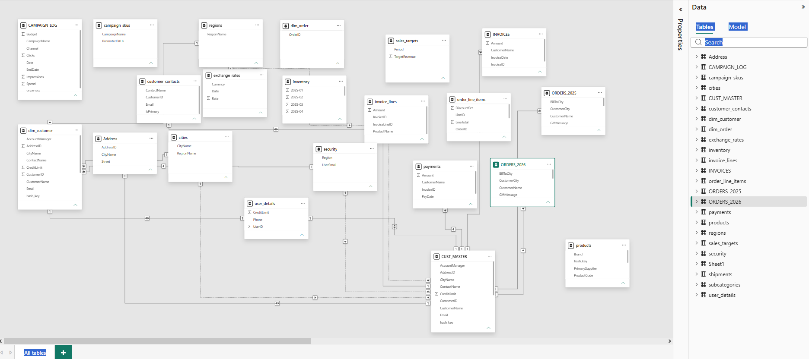
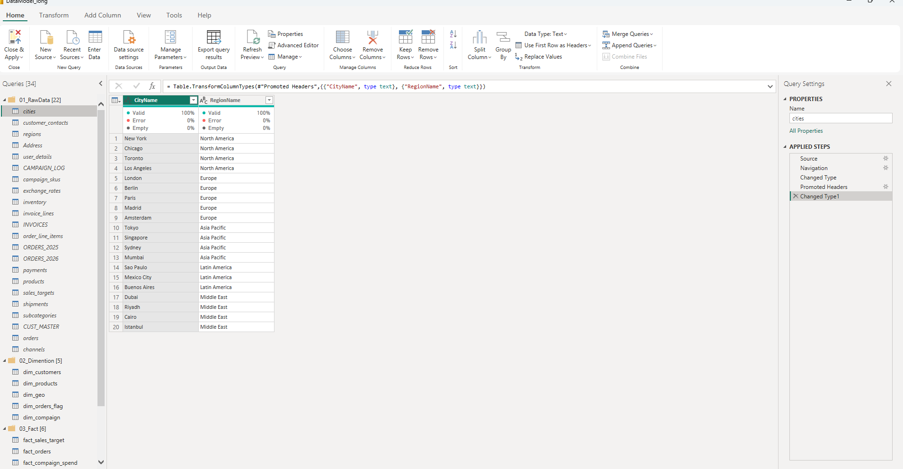
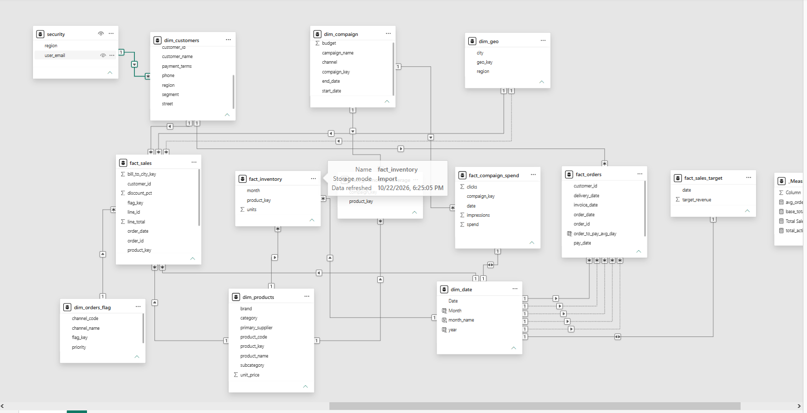

# Power BI – Complex Data Modeling Project

## 📌 Project Overview

This project focuses on building a **clean and structured Power BI data model from 24 complex and messy Excel tables**.

I had previously built four data models during my internship and data challenge projects. However, I had never worked with this kind of complex and messy source structure before.

For this project, I worked with **24 chaotic Excel tables** and transformed them into a clean and structured **Star Schema data model**.

---

## 📊 Power BI Resources

### 🔗 Live Power BI Report

[**View the Power BI Report**](https://app.powerbi.com/groups/me/reports/f00a419d-b4a7-46f6-8757-3c4fdad317e5/e49375a859de7ba6cb42?experience=power-bi)

### 🔗 Power BI Data Model

[**View the Power BI Data Model**](https://app.powerbi.com/groups/me/modeling/03e597cf-ee24-402e-ad50-df675ee090ea/modelView?experience=power-bi)

> **Note:** The Power BI report and data model may require appropriate Power BI access or permission to view.

---

## 🎯 Project Objective

The main objective was to:

- Understand a complex source data structure
- Identify the purpose and grain of each table
- Separate Fact and Dimension tables
- Build a clean Star Schema
- Create appropriate relationships
- Perform data cleaning and transformation
- Prepare the model for business analysis
- Implement Region-based **Row-Level Security (RLS)**

---

## 🔄 Data Modeling Approach

### Step 1 – Load Source Data

Loaded all **24 Excel worksheets** into Power BI using Power Query.

### Step 2 – Understand the Source Data

Before creating relationships, I carefully examined:

- Each table
- Each column
- Data types
- Duplicate values
- Missing values
- Relationships between tables
- Business meaning of the data

This helped avoid incorrect assumptions while designing the model.

**Source tables loaded into Power Query:**

### Step 3 – Build the Star Schema

Created a structured **Star Schema** by following important data-modeling principles:

- Fact tables at the center
- Dimension tables surrounding the fact tables
- One-to-Many / Many-to-One relationships
- Single-direction filtering where appropriate
- Avoiding unnecessary snowflake structures
- Maintaining a clean and understandable model

**Clean Star Schema Data Model:**

### Step 4 – Identify Fact and Dimension Tables

Based on the business meaning and grain of the source data, I identified which tables should be treated as:

- **Fact Tables**
- **Dimension Tables**

Understanding the **grain of each table** was an important part of this process.

### Step 5 – Data Cleaning & Transformation

Performed data preparation using **Power Query**, including:

- Correcting data types
- Cleaning data
- Standardizing text formats
- Handling inconsistent values
- Merge operations
- Append operations
- Removing unnecessary complexity

### Step 6 – Business Analysis

After creating the clean data model, the model was prepared to answer the required **business questions and analytical requirements**.

### Step 7 – Row-Level Security

Implemented **Row-Level Security (RLS)** using a security mapping table.

This allows users to access data based on their assigned **Region**.

---

## 🧠 Key Learnings

The biggest learning from this project was:

> **Data modeling is not just about creating relationships between tables.**

A good data model starts with:

1. Understanding the source data
2. Understanding the business requirements
3. Identifying the grain of each table
4. Separating Facts and Dimensions
5. Creating appropriate relationships
6. Applying correct filtering behavior
7. Building a model that supports business analysis

This project helped me understand how to take a **large and messy source structure** and transform it into a **clean, organized, and analysis-ready Power BI data model**.

---

## 🛠️ Tools & Technologies

- **Microsoft Power BI**
- **Power Query**
- **DAX**
- **Excel**
- **Data Modeling**
- **Star Schema**
- **Row-Level Security (RLS)**

---

## 📈 Project Highlights

| Area | Details |
|---|---|
| Source | Excel |
| Source Tables | 24 |
| Data Preparation | Power Query |
| Data Model | Star Schema |
| Relationships | One-to-Many / Many-to-One |
| Filter Direction | Single Direction where appropriate |
| Security | Region-based RLS |
| BI Tool | Microsoft Power BI |

---

## 🚀 Project Outcome

**24 messy Excel tables → Clean Star Schema → Business-ready Power BI data model**

This project strengthened my understanding of:

- Power BI Data Modeling
- Power Query
- Star Schema
- Fact and Dimension Tables
- Table Grain
- Relationships
- Data Transformation
- Row-Level Security

---

## 🙏 Acknowledgement

This project was developed as a **hands-on learning exercise** based on the concepts demonstrated by **Bara Sir (@DataWithBara)**.

His video helped me understand how to approach a complex source structure and build a clean Power BI data model.

🎥 [**Reference Video – Complex Power BI Data Modeling**](https://www.youtube.com/watch?v=0A2k62YEbfI&list=PLNcg_FV9n7qZge4KDGqGtqgiuVuhVZWzu&index=27)

---

## 🏷️ GitHub Topics

`power-bi` `data-modeling` `star-schema` `power-query` `dax` `row-level-security` `rls` `business-intelligence` `data-analytics` `data-transformation` `etl` `excel` `semantic-model`# Power BI – Complex Data Modeling Project

## 📌 Project Overview

This project focuses on building a **clean and structured Power BI data model from 24 complex and messy Excel tables**.

I had previously built four data models during my internship and data challenge projects. However, I had never worked with this kind of complex and messy source structure before.

For this project, I worked with **24 chaotic Excel tables** and transformed them into a clean and structured **Star Schema data model**.

---

## 📊 Power BI Resources

### 🔗 Live Power BI Report

[**View the Power BI Report**](https://app.powerbi.com/groups/me/reports/f00a419d-b4a7-46f6-8757-3c4fdad317e5/e49375a859de7ba6cb42?experience=power-bi)

### 🔗 Power BI Data Model

[**View the Power BI Data Model**](https://app.powerbi.com/groups/me/modeling/03e597cf-ee24-402e-ad50-df675ee090ea/modelView?experience=power-bi)

> **Note:** The Power BI report and data model may require appropriate Power BI access or permission to view.

---

## 🎯 Project Objective

The main objective was to:

- Understand a complex source data structure
- Identify the purpose and grain of each table
- Separate Fact and Dimension tables
- Build a clean Star Schema
- Create appropriate relationships
- Perform data cleaning and transformation
- Prepare the model for business analysis
- Implement Region-based **Row-Level Security (RLS)**

---

## 🔄 Data Modeling Approach

### Step 1 – Load Source Data

Loaded all **24 Excel worksheets** into Power BI using Power Query.

### Step 2 – Understand the Source Data

Before creating relationships, I carefully examined:

- Each table
- Each column
- Data types
- Duplicate values
- Missing values
- Relationships between tables
- Business meaning of the data

This helped avoid incorrect assumptions while designing the model.

### Step 3 – Build the Star Schema

Created a structured **Star Schema** by following important data-modeling principles:

- Fact tables at the center
- Dimension tables surrounding the fact tables
- One-to-Many / Many-to-One relationships
- Single-direction filtering where appropriate
- Avoiding unnecessary snowflake structures
- Maintaining a clean and understandable model

### Step 4 – Identify Fact and Dimension Tables

Based on the business meaning and grain of the source data, I identified which tables should be treated as:

- **Fact Tables**
- **Dimension Tables**

Understanding the **grain of each table** was an important part of this process.

### Step 5 – Data Cleaning & Transformation

Performed data preparation using **Power Query**, including:

- Correcting data types
- Cleaning data
- Standardizing text formats
- Handling inconsistent values
- Merge operations
- Append operations
- Removing unnecessary complexity

### Step 6 – Business Analysis

After creating the clean data model, the model was prepared to answer the required **business questions and analytical requirements**.

### Step 7 – Row-Level Security

Implemented **Row-Level Security (RLS)** using a security mapping table.

This allows users to access data based on their assigned **Region**.

---

## 🧠 Key Learnings

The biggest learning from this project was:

> **Data modeling is not just about creating relationships between tables.**

A good data model starts with:

1. Understanding the source data
2. Understanding the business requirements
3. Identifying the grain of each table
4. Separating Facts and Dimensions
5. Creating appropriate relationships
6. Applying correct filtering behavior
7. Building a model that supports business analysis

This project helped me understand how to take a **large and messy source structure** and transform it into a **clean, organized, and analysis-ready Power BI data model**.

---

## 🛠️ Tools & Technologies

- **Microsoft Power BI**
- **Power Query**
- **DAX**
- **Excel**
- **Data Modeling**
- **Star Schema**
- **Row-Level Security (RLS)**

---

## 📈 Project Highlights

| Area | Details |
|---|---|
| Source | Excel |
| Source Tables | 24 |
| Data Preparation | Power Query |
| Data Model | Star Schema |
| Relationships | One-to-Many / Many-to-One |
| Filter Direction | Single Direction where appropriate |
| Security | Region-based RLS |
| BI Tool | Microsoft Power BI |

---

## 🚀 Project Outcome

**24 messy Excel tables → Clean Star Schema → Business-ready Power BI data model**

This project strengthened my understanding of:

- Power BI Data Modeling
- Power Query
- Star Schema
- Fact and Dimension Tables
- Table Grain
- Relationships
- Data Transformation
- Row-Level Security

---

## 🙏 Acknowledgement

This project was developed as a **hands-on learning exercise** based on the concepts demonstrated by **Bara Sir (@DataWithBara)**.

His video helped me understand how to approach a complex source structure and build a clean Power BI data model.

🎥 [**Reference Video – Complex Power BI Data Modeling**](https://www.youtube.com/watch?v=0A2k62YEbfI&list=PLNcg_FV9n7qZge4KDGqGtqgiuVuhVZWzu&index=27)

---

## 🏷️ GitHub Topics

`power-bi` `data-modeling` `star-schema` `power-query` `dax` `row-level-security` `rls` `business-intelligence` `data-analytics` `data-transformation` `etl` `excel` `semantic-model`
